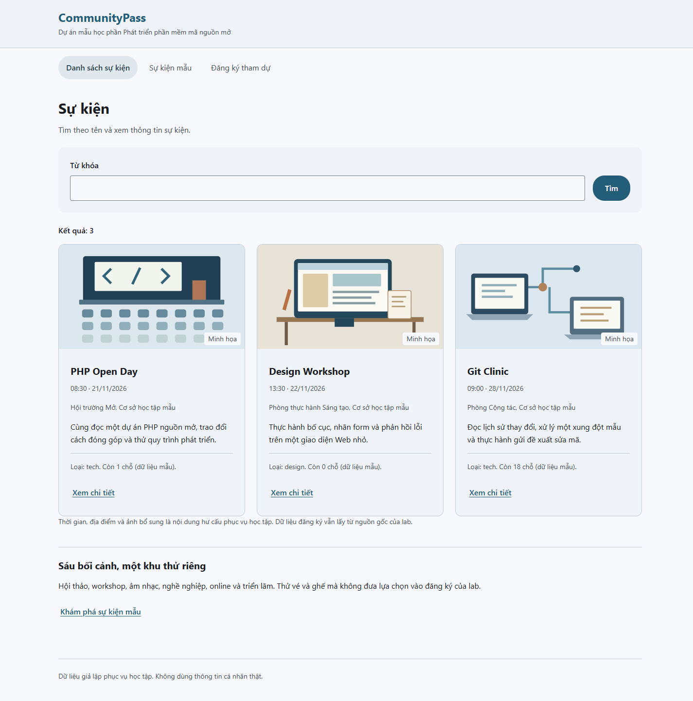
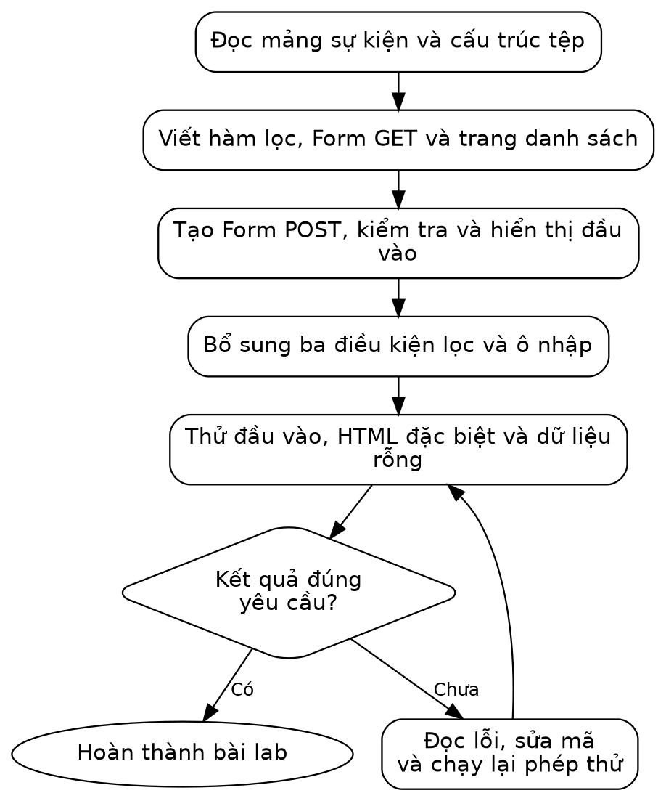
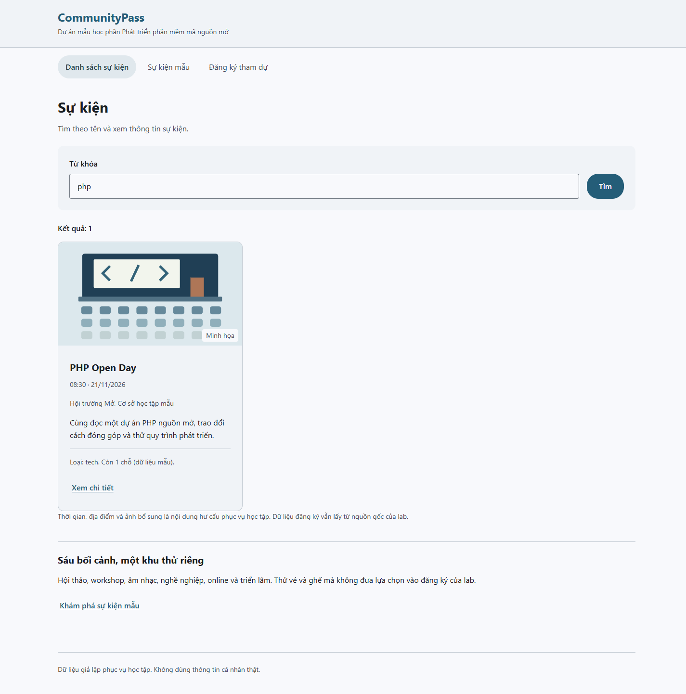

# LAB 03 — HIỂN THỊ SỰ KIỆN, TÌM KIẾM VÀ XỬ LÝ FORM

Học phần: Phát triển phần mềm mã nguồn mở. Đối tượng: sinh viên năm 3, chuyên ngành Phát triển phần mềm. Bài thực hành sử dụng mã nguồn CommunityPass được cấp trong thư mục Ma\_nguon.

## I. MỤC TIÊU VÀ CHUẨN BỊ

Nội dung bài giảng: Chương 3, slide 9–15: mảng; 16–20: Form, chuyển hướng, GET/POST; 21–22: include/require. Số trang tính cả trang bìa. Git và kiểm thử được sử dụng để hỗ trợ thực hành.

Sau khi hoàn thành bài thực hành, sinh viên có khả năng:

- Duyệt mảng kết hợp và tách dữ liệu, hàm xử lý, giao diện.
- Giải thích GET/POST, nhận dữ liệu và kiểm tra ở máy chủ.
- Xử lý ký tự đặc biệt khi hiển thị HTML; phân biệt kết quả xem trước với dữ liệu đã lưu.
- Hoàn thiện bộ lọc kết hợp và giao diện nhận điều kiện; xử lý Form đúng với dữ liệu hợp lệ và không hợp lệ.

Chuẩn bị: đọc nội dung bài giảng được nêu trên, giải nén trọn thư mục của lab và mở Ma\_nguon trong trình soạn thảo. Bài đã có đủ mã và dữ liệu khởi đầu; chỉ sửa những tệp được chỉ rõ trong phần hướng dẫn và bài tự làm.

### Công cụ cần có

Sử dụng terminal Ubuntu hoặc Ubuntu trong WSL, PHP từ 8.1 và Git. Nếu máy đã có đủ công cụ, chỉ cần kiểm tra phiên bản. Trên máy được phép cài phần mềm, thực hiện:

```bash
sudo apt update
sudo apt install php-cli git unzip
php -v
git --version
```

Các lệnh Bash chạy trong terminal Ubuntu, không chạy trong PowerShell. Bài này không cần cơ sở dữ liệu hoặc framework.

### Bối cảnh và nội dung thực hành

Bài thực hành xây trang danh sách sự kiện, tìm kiếm theo từ khóa và Form đăng ký. Dữ liệu sự kiện được nạp từ mảng PHP; kết quả đăng ký là bản xem trước và chưa lưu vào cơ sở dữ liệu.



*Danh sách sự kiện của mã mẫu*

Sau khi nhập php, trang chỉ còn PHP Open Day. Khi gửi họ tên và email hợp lệ, trang hiển thị nội dung đã nhận. Đây là bản xem trước, không phải đăng ký đã được lưu.

## II. QUY TRÌNH THỰC HÀNH



*Sơ đồ hướng thực hiện Lab 03*

Sơ đồ thể hiện thứ tự thực hiện và các bước kiểm tra. Tại nút quyết định hình thoi, đối chiếu kết quả với yêu cầu; nếu chưa đạt, quay lại bước xử lý tương ứng trước khi tiếp tục.

Mở thư mục Lab03/Ma\_nguon bằng trình soạn thảo và mở terminal Ubuntu tại thư mục này. Chạy pwd và ls để kiểm tra vị trí; danh sách tệp cần có lab.sh. Các đường dẫn trong bài được tính từ Ma\_nguon. Trên Windows, thực hiện lệnh Bash trong Ubuntu/WSL.

```bash
bash lab.sh check
bash lab.sh run
```

Kết quả chạy: mở http://127.0.0.1:8103. Giữ terminal máy chủ mở, dùng terminal thứ hai tại cùng thư mục để sửa/chạy test. Dừng bằng Ctrl+C; không mở hai máy chủ cùng cổng.

Kiểm tra trước khi thực hành:

- [ ] Lệnh check xác nhận đủ công cụ để chạy bài thực hành.
- [ ] Chạy được chương trình mẫu và xác định được thư mục chứa mã nguồn.
- [ ] Phân biệt lệnh test dùng cho bài mẫu và lệnh extend dùng cho bài tập mở rộng.

## III. CẤU TRÚC MÃ NGUỒN VÀ LUỒNG XỬ LÝ

Thư mục Lab03/Ma\_nguon đã có mã mẫu cho phần hướng dẫn. Chạy mẫu trước để xem kết quả, sau đó đọc và thực hiện lại các bước ở phần IV trên chính các tệp đó. Khi bài yêu cầu thay toàn bộ nội dung, không chép nối thêm một hàm hoặc lớp trùng tên. Phần mở rộng để sinh viên tự hoàn thiện ở mục VI.

| **Phần thực hành** | **Tệp và công việc** | **Kết quả cần đạt** |
| --- | --- | --- |
| Mẫu có hướng dẫn | src/EventFilter.php; public/index.php; public/register.php; data/events.php<br>Đọc và thực hiện lại chức năng tìm theo từ khóa và Form đăng ký. Giải thích luồng GET/POST và cách kiểm tra dữ liệu. | Từ khóa php: 1 sự kiện; xyz: 0. Form hợp lệ có PREVIEW\_OK. bash lab.sh test: TESTS=7 FAILED=0. |
| Bài tự mở rộng | src/EventFilter.php; public/index.php<br>Bổ sung lọc kết hợp từ khóa, loại và còn chỗ bằng AND. Thêm hai điều kiện vào Form; giữ lại lựa chọn sau khi gửi. | bash lab.sh extend: TESTS=8 FAILED=0. Git + tech + còn chỗ trả ID 3. Kiểm tra thêm hai điều kiện trên trang Web. |

Vai trò từng tệp trong bài mẫu:

| **Tệp** | **Bạn làm gì trong bài?** |
| --- | --- |
| data/events.php | Đọc mảng được cấp; hiểu từng trường dữ liệu. |
| src/EventFilter.php | Tạo hàm tìm sự kiện theo từ khóa. |
| src/Input.php | Đọc các hàm kiểm tra đầu vào và hiển thị an toàn đã cấp. |
| public/index.php | Tạo trang danh sách có form tìm kiếm. |
| public/register.php | Tạo form POST và hiển thị kết quả kiểm tra. |
| templates/header.php, footer.php | Thành phần giao diện có sẵn; nạp lại ở các trang. |

Luồng tìm kiếm: trình duyệt gửi q qua GET → index.php đọc từ khóa → filterEvents chọn sự kiện → vòng lặp dựng HTML. Luồng đăng ký: trình duyệt gửi các trường qua POST → register.php gọi validateRegistration → hiển thị lỗi hoặc bản xem trước.

## IV. HƯỚNG DẪN THỰC HÀNH

### Bước 1. Xem mảng dữ liệu sự kiện

Mở data/events.php. Tệp đã có nội dung:

```php
<?php
return [
 ['id'=>1, 'title'=>'PHP Open Day', 'category'=>'tech', 'capacity'=>10, 'registered'=>9],
 ['id'=>2, 'title'=>'Design Workshop', 'category'=>'design', 'capacity'=>5, 'registered'=>5],
 ['id'=>3, 'title'=>'Git Clinic', 'category'=>'tech', 'capacity'=>20, 'registered'=>2],
];
```

Tệp chứa mảng gồm ba sự kiện. Mỗi sự kiện có các trường dữ liệu, trong đó capacity là sức chứa và registered là số người đăng ký giả lập. Lệnh return cho phép nơi gọi require nhận lại mảng này.

Kiểm tra kết quả bước 1:

- [ ] Xác định danh sách có 3 sự kiện và các khóa id/title/category/capacity/registered.

### Bước 2. Tạo hàm lọc

Mở src/EventFilter.php và đối chiếu với mã dưới đây. Nếu viết lại tệp, thay nội dung hiện tại; tránh khai báo trùng hàm hoặc lớp:

```php
<?php
declare(strict_types=1);
 
function filterEvents(array $events, string $query): array
{
    $result = [];
    foreach ($events as $event) {
        $matches = $query === ''
            || stripos($event['title'], $query) !== false;
        if ($matches) {
            $result[] = $event;
        }
    }
    return $result;
}
```

Hàm bắt đầu với mảng kết quả rỗng, duyệt từng sự kiện và chỉ thêm sự kiện phù hợp. stripos tìm vị trí từ khóa không phân biệt hoa/thường trong phạm vi chuỗi của bài; trả false nếu không tìm thấy. Vì vị trí đầu tiên có thể là số 0, phải dùng !== false, không viết if (stripos(...)).

Từ khóa rỗng nghĩa là lấy tất cả. Hàm chỉ trả dữ liệu, không in HTML; cùng cách tách xử lý khỏi hiển thị đã dùng trong lớp xử lý PHP. Bài mẫu chưa hỗ trợ tìm tiếng Việt không dấu hoặc chuẩn hóa Unicode.

Kiểm tra kết quả bước 2:

- [ ] Hàm filterEvents nhận mảng và từ khóa, trả mảng mới không sửa đầu vào.

### Bước 3. Đọc hai hàm hỗ trợ đầu vào và hiển thị

Mở src/Input.php, tìm hai hàm sau (đã được cấp, không tạo thêm bản trùng):

```php
function field(array $input, string $key): string
{
    $value = $input[$key] ?? '';
    return is_string($value) ? trim($value) : '';
}
 
function e(string $value): string
{
    return htmlspecialchars(
        $value, ENT_QUOTES | ENT_SUBSTITUTE, 'UTF-8'
    );
}
```

field đọc một trường, bỏ khoảng trắng ở hai đầu và không nhận mảng thay cho chuỗi. ?? cung cấp giá trị mặc định khi không có trường. Hàm e đổi ký tự đặc biệt trước khi chèn văn bản vào HTML; nó không làm sạch mọi loại dữ liệu và không thay thế kiểm tra nghiệp vụ.

Kiểm tra kết quả bước 3:

- [ ] Phân biệt field lấy chuỗi an toàn và e xử lý ký tự khi hiển thị HTML.

### Bước 4. Tạo trang danh sách hoàn chỉnh

Mở public/index.php và đối chiếu với mã dưới đây. Nếu viết lại tệp, thay nội dung hiện tại; tránh khai báo trùng hàm hoặc lớp:

```php
<?php
require __DIR__ . '/../src/Input.php';
require __DIR__ . '/../src/EventFilter.php';
$events = require __DIR__ . '/../data/events.php';
$query = field($_GET, 'q');
$visible = filterEvents($events, $query);
require_once __DIR__ . '/../templates/event-presentation.php';
require __DIR__ . '/../templates/header.php';
?>
<div class="page-heading page-heading--list page-search">
<h1>Sự kiện</h1>
<p>Tìm theo tên và xem thông tin sự kiện.</p>
</div>
<form class="search-form" method="get">
    <label class="form-field" for="q">Từ khóa
<input id="q" name="q" value="<?= e($query) ?>">
    </label>
    <button>Tìm</button>
</form>
<p class="result-count">Kết quả: <?= count($visible) ?></p>
<section class="event-list" aria-label="Danh sách sự kiện">
<?php foreach ($visible as $event): ?>
    <article class="event-item event-card">
<?php $content = uiContent((int)$event['id']); ?>
<figure class="event-cover">
" alt="<?= e($content['alt']) ?>" width="960" height="540">
<figcaption>Minh họa</figcaption>
</figure>
<div class="event-card-content">
        <h2 class="event-title"><?= e($event['title']) ?></h2>
<p class="event-date"><?= e(uiDate($content['start'])) ?></p>
<p class="event-venue"><?= e($content['venue']) ?></p>
<p><?= e($content['summary']) ?></p>
<p class="event-meta">
        Loại: <?= e($event['category']) ?>. 
        Còn <?= max(0, $event['capacity'] - $event['registered']) ?>
        chỗ (dữ liệu mẫu).
    </p>
<a class="text-button" href="/event.php?id=<?= (int)$event['id'] ?>">Xem chi tiết</a>
</div>
</article>
<?php endforeach; ?>
</section>
<?php if (!$visible): ?>
    <p class="empty-state">Không có kết quả.<span>Thử tìm với một từ khóa khác.</span>
</p>
<?php endif; ?>
<p class="content-note">Thời gian, địa điểm và ảnh bổ sung là nội dung hư cấu phục vụ học tập. Dữ liệu đăng ký vẫn lấy từ nguồn gốc của lab.</p>
<section class="demo-entry"><h2>Sáu bối cảnh, một khu thử riêng</h2>
<p>Hội thảo, workshop, âm nhạc, nghề nghiệp, online và triển lãm. Thử vé và ghế mà không đưa lựa chọn vào đăng ký của lab.</p>
<a class="text-button" href="/ui-demo.php">Khám phá sự kiện mẫu</a></section>
<?php require __DIR__ . '/../templates/footer.php'; ?>
```

Đọc theo thứ tự: ba lệnh require đầu nạp hàm và dữ liệu; $query đọc từ khóa; $visible nhận danh sách kết quả; header được nạp trước phần HTML, footer ở cuối. name="q" là tên trường để PHP đọc $\_GET\['q'\]; value giữ lại từ khóa sau khi gửi form. Dấu &lt;?= ... ?&gt; in một giá trị vào HTML.

Đoạn foreach ... endforeach chỉ lặp qua kết quả tìm được, không phải mảng gốc. if (!$visible) xử lý mảng rỗng. Cú pháp dạng dấu : giúp trộn vòng lặp với HTML dễ nhìn hơn; ý nghĩa vẫn là vòng lặp PHP đã học.

Kiểm tra kết quả bước 4:

- [ ] Trang dùng require/foreach và form GET; biết dòng nào gọi hàm lọc.

### Bước 5. Chạy trang và đối chiếu

```bash
bash lab.sh run
```

Mở http://127.0.0.1:8103. Không nhập từ khóa: 3 sự kiện. Nhập php: 1 sự kiện. Nhập xyz: 0 và có thông báo không tìm thấy. Quan sát URL có ?q=php; đây là dữ liệu GET.



*Kết quả tìm kiếm từ khóa php*

Kiểm tra kết quả bước 5:

- [ ] Từ khóa php có 1, xyz có 0, để trống có 3 sự kiện.

### Bước 6. Hiểu quy tắc kiểm tra form đã cấp

Trong src/Input.php, đọc validateRegistration. Hàm nhận dữ liệu form và danh sách sự kiện. Nó kiểm tra ID phải có trong danh sách; họ tên không rỗng; email đúng định dạng cơ bản. Kết quả luôn có hai phần: errors chứa mã lỗi, data chứa dữ liệu đã xử lý.

Theo quy ước của bài mẫu, email được chuyển sang chữ thường bằng strtolower. Độ dài họ tên được kiểm tra bằng strlen, tính theo byte, không phải số ký tự tiếng Việt. Kiểm tra dữ liệu và xử lý ký tự HTML là hai công việc riêng \[PHP-INPUT\].

Kiểm tra kết quả bước 6:

- [ ] Xác định được nơi kiểm tra ID sự kiện, tên và email trên máy chủ.

### Bước 7. Tạo trang tiếp nhận form

Mở public/register.php và thay toàn bộ nội dung bằng đoạn mã dưới; không chép nối vào phần đang có:

```php
<?php
require __DIR__ . '/../src/Input.php';
$events = require __DIR__ . '/../data/events.php';
$result = null;
if ($_SERVER['REQUEST_METHOD'] === 'POST') {
    $result = validateRegistration($_POST, $events);
}
require __DIR__ . '/../templates/header.php';
?>
<div class="page-heading">
<h1>Đăng ký tham dự</h1>
<p>Điền thông tin để kiểm tra và xem trước. Chưa lưu đăng ký.</p>
</div>
<form class="registration-form" method="post">
    <label class="form-field" for="event_id">Sự kiện
<select id="event_id" name="event_id">
            <?php foreach ($events as $event): ?>
                <option value="<?= $event['id'] ?>">
                    <?= e($event['title']) ?>
                </option>
            <?php endforeach; ?>
        </select>
    </label>
    <label class="form-field" for="name">Họ tên
<input id="name" name="name" maxlength="120"
               value="<?= e(field($_POST, 'name')) ?>">
    </label>
    <label class="form-field" for="email">Email
<input id="email" name="email"
               value="<?= e(field($_POST, 'email')) ?>">
    </label>
    <button>Kiểm tra</button>
</form>
<?php if ($result !== null): ?>
    <?php if ($result['errors']): ?>
        <div class="error-summary" role="alert">
<p class="error-messages"><?= e(implode(', ', $result['errors'])) ?></p>
<p>Thông tin chưa hợp lệ. Kiểm tra lại các thông tin đã nhập rồi gửi lại.</p>
</div>
    <?php else: ?>
        <section class="preview" role="status">
<h2>Xem trước thông tin</h2>
<p class="status-message">PREVIEW_OK: <?= e($result['data']['name']) ?>
            — <?= e($result['data']['email']) ?></p>
        <p>Chỉ xem trước; chưa lưu Session hoặc CSDL.</p>
</section>
    <?php endif; ?>
<?php endif; ?>
<?php require __DIR__ . '/../templates/footer.php'; ?>
```

Lần mở trang đầu dùng GET: $result là null, chưa hiển thị kết quả. Khi bấm Kiểm tra, trình duyệt POST đến chính trang hiện tại vì form không đặt action. PHP chỉ gọi hàm validation trong nhánh POST.

Danh sách chọn gửi ID sự kiện; các ô họ tên và email sử dụng thuộc tính name để PHP đọc dữ liệu. Khi có lỗi, Form giữ lại họ tên và email để chỉnh sửa. Bản mẫu chưa giữ lựa chọn sự kiện sau lỗi; sinh viên có thể bổ sung chức năng này.

implode nối các mã lỗi để hiển thị. Chỉ khi mảng lỗi rỗng mới có PREVIEW\_OK. Không tạo bản ghi, vé hoặc số đăng ký trong bài này.

Kiểm tra kết quả bước 7:

- [ ] Trang register.php nhận POST và hiển thị kết quả xem trước, chưa ghi CSDL.

### Bước 8. Thử dữ liệu đúng, sai và đặc biệt

Mở /register.php và thử theo bảng. Chạy trên máy cục bộ, không thử trên website bên ngoài.

| **Dữ liệu** | **Kết quả cần quan sát** |
| --- | --- |
| Sự kiện 1, họ tên O'Neil, email demo@example.test | Có PREVIEW\_OK, tên chứa dấu nháy vẫn đúng. |
| Họ tên trống, email bad | Có mã lỗi, không có PREVIEW\_OK. |
| Họ tên &lt;b&gt;Demo&lt;/b&gt;, email hợp lệ | Hiển thị nguyên văn, không biến thành thẻ chữ đậm. |
| Từ khóa không có kết quả | Danh sách rỗng nhưng trang vẫn hoạt động. |

Dừng máy chủ rồi chạy php tests/run.php. Có 7 ca và FAILED=0. Ca dữ liệu ID không tồn tại được kiểm tra qua test; dropdown không tự cho người dùng chọn ID sai nhưng máy chủ vẫn phải phòng trường hợp đó.

Kiểm tra kết quả bước 8:

- [ ] Tên chứa &lt;b&gt; hiển thị nguyên văn; email sai không được PREVIEW\_OK.

Kết quả sau phần hướng dẫn: Từ khóa php: 1 sự kiện; xyz: 0. Form hợp lệ có PREVIEW\_OK. bash lab.sh test: TESTS=7 FAILED=0.

## V. LỖI THƯỜNG GẶP VÀ CÁCH KHẮC PHỤC

| **Hiện tượng** | **Cách kiểm tra** |
| --- | --- |
| Không thấy thay đổi vừa sửa | Bạn có còn chạy máy chủ từ thư mục bản khác? Dừng máy chủ bằng Ctrl+C và chạy lại bash lab.sh run tại Ma\_nguon đang sửa. |
| Cannot redeclare ... | Một hàm có bị chép hai lần không? Giữ mỗi định nghĩa ở đúng một tệp. |
| Tìm từ nằm ở đầu tiêu đề không ra | So sánh stripos với !== false, đừng coi vị trí 0 là không tìm thấy. |
| Lỗi tên trường không tồn tại | Kiểm tra name của input và khóa truyền cho field. |
| Chữ nhập vào biến thành HTML | Kiểm tra những nơi in dữ liệu có dùng e không. |

## VI. BÀI TẬP MỞ RỘNG: KẾT HỢP BA BỘ LỌC

```bash
# Vẫn đứng trong Ma_nguon của bài này.
bash lab.sh extend
```

Hoàn thiện src/EventFilter.php để lọc đồng thời theo từ khóa, loại sự kiện và tình trạng còn chỗ. Trang ban đầu có ô nhập từ khóa; sinh viên bổ sung ô chọn loại và tùy chọn còn chỗ theo yêu cầu dưới đây. Giữ tên hàm, tham số và dữ liệu kiểm thử theo yêu cầu.

| **Bộ lọc** | **ID cần trả về** |
| --- | --- |
| Không lọc | 1, 2, 3 |
| php | 1 |
| Loại tech | 1, 3 |
| Chỉ còn chỗ | 1, 3 |
| Git + tech + còn chỗ | 3 |
| design + còn chỗ | Rỗng |
| Loại không tồn tại | Rỗng |

Chạy bash lab.sh extend; kết quả yêu cầu là TESTS=8 FAILED=0. Hàm cần trả mảng mới, không thay đổi mảng đầu vào và không chèn HTML vào kết quả. Kiểm tra thêm trên giao diện: các điều kiện đã chọn phải được giữ lại sau khi gửi Form.

### Nối bộ lọc mở rộng vào cùng trang đang làm

Mở src/EventFilter.php. Hàm cần nhận thêm hai tham số tùy chọn:

```php
function filterEvents(array $events, string $query,
    string $category = '', bool $availableOnly = false): array
```

Sửa hàm hiện có, không khai báo thêm hàm trùng tên. Sau khi các ca kiểm thử đạt, mở public/index.php và thêm phần đọc điều kiện ngay sau dòng đọc từ khóa:

```php
$category = field($_GET, 'category');
$availableOnly = field($_GET, 'available') === '1';
$visible = filterEvents($events, $query, $category, $availableOnly);
```

Thay lời gọi filterEvents hiện tại bằng lời gọi có đủ tham số. Giữ tên biến kết quả thống nhất với vòng lặp hiển thị ($visible hoặc $items). Thêm ô chọn loại và ô đánh dấu còn chỗ vào Form GET, lần lượt dùng name="category" và name="available"; giá trị khi đánh dấu là 1. Giữ lại các lựa chọn sau khi gửi Form.

## KẾT QUẢ CỦA BÀI THỰC HÀNH

Có trang danh sách, bộ lọc theo từ khóa/loại/còn chỗ và Form đăng ký kiểm tra phía máy chủ. Dữ liệu đăng ký hợp lệ hiển thị ở mức xem trước, chưa lưu CSDL.

## VII. BẢNG KIỂM HOÀN THÀNH

- [ ] Từ khóa php chỉ trả PHP Open Day; xyz trả danh sách rỗng.
- [ ] Ba điều kiện lọc hoạt động trên cùng trang và được giữ lại.
- [ ] Form thiếu họ tên hoặc email sai trả lỗi tại máy chủ.
- [ ] Giá trị có dấu nháy/ký tự HTML được hiển thị như dữ liệu.
- [ ] test và extend đạt; trang hiển thị khớp kết quả hàm lọc.

Kết quả tổng hợp của phần tự làm phải có TESTS=8 FAILED=0. Ngoài các phép thử tự động, thực hiện các tình huống kiểm tra trực tiếp nêu trong bài. Lệnh check chỉ xác nhận môi trường, không thay cho test và extend.

## VIII. RUBRIC LAB — 10 ĐIỂM

| **Tiêu chí** | **Điểm** | **Cách chấm** |
| --- | --- | --- |
| Phần mẫu có hướng dẫn | 2,0 | 1 điểm: thực hiện và có kết quả đúng; 1 điểm: giải thích luồng mã. Mỗi phần đạt một phần: 0,5; chưa đạt: 0. |
| Bộ lọc kết hợp | 1,5 | Từ khóa, loại và còn chỗ kết hợp theo AND; giá trị rỗng xử lý đúng; không sửa mảng gốc. |
| Giao diện sử dụng bộ lọc | 1,5 | Có ô từ khóa, chọn loại, chọn còn chỗ; Form truyền đủ điều kiện và giữ lựa chọn sau khi gửi. |
| Đầu vào và thông báo | 1,0 | Xử lý không có kết quả, tham số sai và ký tự HTML; dữ liệu hiển thị được mã hóa phù hợp. |
| Kiểm thử và xử lý lỗi | 2,0 | 1 điểm: có dữ liệu và kết quả mong đợi cho tình huống đúng, sai, biên; 1 điểm: chạy lại phần mẫu và mở rộng sau sửa. Mỗi phần đạt một phần: 0,5; chưa đạt: 0. |
| Mã nguồn và bàn giao | 1,0 | 0,5: nộp đúng tệp, dữ liệu và phiên bản; 0,5: README có lệnh chạy/kiểm thử, không chứa cấu hình riêng. Đạt một phần mỗi mục: 0,25. |
| Giải thích cá nhân | 1,0 | 0,5: giải thích phần tự viết; 0,5: giải thích một ca lỗi hoặc thực hiện một thay đổi nhỏ. Đạt một phần mỗi mục: 0,25. |
| Tổng | 10,0 | Chấm trực tiếp sản phẩm và phần giải thích của bài lab. |

Với tiêu chí 1,5 điểm: đủ yêu cầu được 1,5; thực hiện một phần được 0,75; chưa thực hiện được 0. Với tiêu chí 1 điểm không chia tiểu mục: đủ được 1; một phần được 0,5; chưa thực hiện được 0. Bài tự làm không đạt điểm chỉ nhờ thay bộ kiểm thử hoặc ghi sẵn kết quả.

## IX. NỘP BÀI

Bước 1. Lưu mã bài mẫu và bài tự làm tại Lab03/Ma\_nguon, kèm dữ liệu, kiểm thử và README. Loại bỏ .local, mật khẩu và dữ liệu cá nhân thật khỏi bài nộp.

Bước 2. Chạy bash lab.sh check, bash lab.sh test và bash lab.sh extend. Thực hiện các phép kiểm tra trực tiếp trong bài và sửa lỗi trước khi nộp.

Bước 3. Commit, đẩy mã lên GitHub và nộp tên nhóm/thành viên, Lab 03, liên kết Ma\_nguon tại đúng commit. Kiểm tra quyền đọc; kèm lần chạy Actions khi được yêu cầu. Hạn và địa chỉ nộp do giảng viên công bố. Nếu nhận ZIP, giữ nguyên cấu trúc trên.
