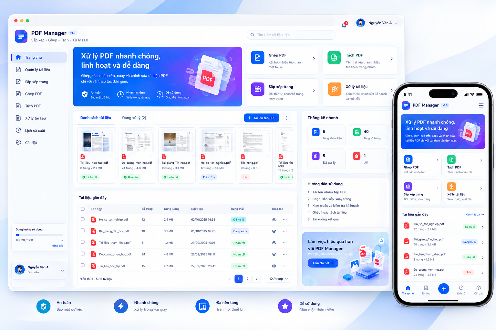
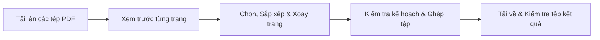
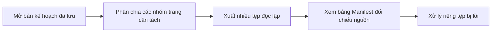

# ĐỀ TÀI 12: XÂY DỰNG CÔNG CỤ SẮP XẾP, GHÉP, TÁCH VÀ XỬ LÝ TÀI LIỆU PDF TRÊN TRÌNH DUYỆT

<p align="center">
  
  
  
  
</p>

---

## 🏛️ THÔNG TIN HỌC PHẦN & NHÓM THỰC HIỆN

- **Trường**: Đại học Đại Nam
- **Khoa**: Công nghệ Thông tin
- **Học phần**: Phát triển phần mềm mã nguồn mở
- **Đề tài**: **Đề tài 12 - Xây dựng công cụ sắp xếp, ghép, tách và xử lý tài liệu PDF trên trình duyệt**

### 👥 Danh Sách Thành Viên Thực Hiện

| STT | Họ và Tên | Mã Sinh Viên | Lớp |
|:---:|---|:---:|:---:|
| **1** | **Đỗ Tiến Sơn** | **1871020508** | **CNTT 18-09** |
| **2** | **Đỗ Huy Anh Duy** | **1871020190** | **CNTT 18-09** |
| **3** | **Vũ Văn Chiến** | **1871020088** | **CNTT 18-09** |

---

## 📸 GIAO DIỆN DEMO HỆ THỐNG (PDF MANAGER v1.0)

Ứng dụng được thiết kế theo phong cách hiện đại, trực quan, hỗ trợ đầy đủ chế độ hiển thị trên Desktop và Thiết bị di động (Responsive):

<p align="center">
  
  <br>
  <em>Hình 1: Bản thiết kế giao diện chính Dashboard và Bộ công cụ xử lý PDF của hệ thống PDF Manager</em>
</p>

---

## 📖 1. BỐI CẢNH VÀ ĐỐI TƯỢNG SỬ DỤNG

### 🎯 Bối Cảnh Thực Tế
Trong học tập và làm việc, người dùng thường xuyên sở hữu nhiều tệp tài liệu PDF rời rạc (chứng chỉ, đề cương, bảng điểm, biểu mẫu hành chính) và cần kết hợp thành một bộ hồ sơ đồng nhất, loại bỏ các trang trắng/trang thừa hoặc xoay lại các trang bị scan ngược chiều. Các công cụ trực tuyến hiện nay thường bắt buộc tải tệp lên máy chủ bên thứ ba gây rủi ro lộ dữ liệu, hoặc yêu cầu trả phí để thực hiện các thao tác căn bản.

Ứng dụng **PDF Manager** mang lại giải pháp xử lý PDF trực tiếp và an toàn:
- Xem trước từng trang trực quan trên trình duyệt.
- Lựa chọn linh hoạt từng trang từ nhiều tệp khác nhau (Ví dụ: lấy trang 2 của tệp A, hai trang của tệp B ghép theo thứ tự đã định).
- File xuất ra chuẩn xác tuyệt đối với những gì người dùng quan sát trên bản xem trước.

### 👤 Đối Tượng Người Sử Dụng
1. **Người chuẩn bị hồ sơ**: Nhân viên hành chính, nhân sự cần ghép hợp đồng, scan tài liệu xác thực.
2. **Giảng viên**: Soạn giáo trình, ghép đề cương môn học, bài tập và đề thi từ nhiều nguồn tham khảo.
3. **Sinh viên**: Đóng gói hồ sơ thực tập, báo cáo khóa luận, tiểu luận môn học.
> 🔒 **Quy tắc bảo mật**: Mỗi tài khoản người dùng chỉ có quyền truy cập, thao tác và tải xuống các tệp tài liệu thuộc quyền sở hữu của chính mình.

---

## ⚡ 2. CÁC CHỨC NĂNG CHÍNH HOÀN THÀNH

Hệ thống được thiết kế hoàn chỉnh theo 5 nhóm chức năng nghiệp vụ trọng tâm:

| Chức Năng | Tên Chức Năng | Chi Tiết Nghiệp Vụ & Kỹ Thuật |
|:---:|---|---|
| **CN 1** | **Tiếp nhận & Xem trước** | - Nhận tải lên nhiều tệp PDF cùng lúc.<br>- Kiểm tra định dạng (MIME check), kích thước tệp và tổng số trang.<br>- Hiển thị danh sách thumbnail ảnh xem trước kèm tên tệp gốc và số trang ban đầu. |
| **CN 2** | **Thao tác biên tập trang** | - Chọn giữ lại hoặc loại bỏ các trang không cần thiết.<br>- Đổi thứ tự trang thông qua kéo - thả trực quan.<br>- Xoay trang theo các góc **90°**, **180°** hoặc **270°**.<br>- Cập nhật tức thì bản xem trước và hỗ trợ **Hoàn tác (Undo)** thao tác vừa thực hiện. |
| **CN 3** | **Ghép & Tách trang** | - Ghép các trang đã chọn từ nhiều file thành một tài liệu duy nhất.<br>- Tách một tài liệu thành nhiều nhóm tệp PDF độc lập.<br>- Thực hiện **Pre-flight Validation** (kiểm tra kế hoạch logic) trước khi gửi lệnh tạo tệp. |
| **CN 4** | **Lưu kế hoạch & Quản lý việc xuất** | - Cho phép lưu tạm bản thảo kế hoạch chỉnh sửa (`edit_plans`) để tiếp tục sau.<br>- Quản lý từng lần xuất qua `export_jobs`, cập nhật tiến độ thực thi.<br>- Cách ly lỗi theo từng tệp riêng biệt và cho phép **Thử lại (Retry)** tệp bị lỗi mà không cần chạy lại toàn bộ. |
| **CN 5** | **Xuất tệp, Tra cứu nguồn & Phân quyền** | - Cho phép tải xuống tệp kết quả hoàn chỉnh.<br>- Xem bảng đối chiếu trang nguồn (**Source Manifest**) để xác minh từng trang đầu ra lấy từ tệp và trang gốc nào.<br>- Xóa tài liệu theo quyền sở hữu. **Tệp gốc được giữ nguyên vẹn 100% (Immutable)**. |

---

## 🎬 3. HAI TÌNH HUỐNG SỬ DỤNG THỰC TẾ

### 🔹 Tình huống 1: Chuẩn bị bộ hồ sơ hoàn chỉnh từ nhiều nguồn

- **Mô tả**: Người dùng tải lên `Tai_lieu_hoc_tap.pdf`, `De_cuong_mon_hoc.pdf` và `Ho_so_tot_nghiep.pdf`. Người dùng kéo trang 2 của tệp A, trang 1 của tệp B, trang 1 của tệp A ghép lại, xoay trang bị ngược 90 độ, rồi nhấn Ghép và tải tệp kết quả về mở kiểm tra.

### 🔹 Tình huống 2: Mở kế hoạch đã lưu, tách nhóm và đối chiếu nguồn

- **Mô tả**: Giảng viên mở lại một kế hoạch biên soạn từ tuần trước, chọn nhóm 1 (trang 1-3) và nhóm 2 (trang 4-5) để xuất ra hai tệp riêng. Hệ thống hiển thị rõ ràng từng trang của hai tệp lấy từ nguồn nào; nếu một tệp gặp sự cố, hệ thống cho phép thử lại riêng tệp đó mà không làm hỏng tệp đã thành công.

---

## 📊 4. BỘ DỮ LIỆU THỬ NGHIỆM & PHẠM VI HỖ TRỢ

Nhóm xây dựng bộ dữ liệu thử nghiệm chuẩn gồm **6 tệp PDF**, tổng cộng **40 trang**, bao phủ toàn diện các tình huống thực tế:

| Tên Tệp Thử Nghiệm | Số Trang | Định Dạng / Khổ Giấy | Nhãn Nhận Diện | Đặc Điểm Kiểm Thử |
|---|:---:|---|:---:|---|
| `Tai_lieu_hoc_tap.pdf` | 8 | A4 Chuẩn Dọc (Portrait) | `A1` - `A8` | File mẫu cơ bản, kiểm tra ghép và xoay. |
| `De_cuong_mon_hoc.pdf` | 24 | A4 Xen kẽ Ngang (Landscape) | `B1` - `B24` | Kiểm tra tài liệu nhiều trang và đa dạng hướng. |
| `Bai_giang_Tin_hoc.pdf` | 18 | Khổ màn hình trình chiếu (16:9) | `C1` - `C18` | Kiểm tra tài liệu có tỉ lệ kích thước đặc biệt. |
| `Ho_so_tot_nghiep.pdf` | 12 | Khổ Letter / Đa kích thước | `D1` - `D12` | Kịch bản ghép hồ sơ thực tế. |
| `File_rong.pdf` | 0 | Tệp rỗng (0 KB) | - | Thử nghiệm từ chối tệp không có nội dung. |
| `File_hong.pdf` | - | Header hỏng (Corrupted PDF) | - | Thử nghiệm cơ chế cách ly lỗi hệ thống. |

### 🔒 Phạm Vi Hỗ Trợ & Ranh Giới An Toàn:
- ✅ Chỉ xử lý các tệp PDF không cài mật khẩu (Unencrypted).
- ❌ Không yêu cầu nhận dạng chữ quang học (OCR).
- ❌ Không chỉnh sửa nội dung văn bản trực tiếp trong trang hay bảo lưu chữ ký số.
- 🛡️ Cấu hình giới hạn dung lượng tệp tối đa: `MAX_FILE_SIZE_MB = 25MB`.
- ⏱️ Cấu hình giới hạn thời gian thực thi: `MAX_EXECUTION_TIME = 60s`.
- 🚫 Không nhận và không thực thi bất kỳ lệnh hệ thống tùy ý nào từ phía người dùng.

---

## 📂 5. CẤU TRÚC THƯ MỤC DỰ ÁN (CHUẨN KIẾN TRÚC LARAVEL)

Dự án được thiết kế và chuẩn hóa hoàn toàn theo **Kiến trúc tiêu chuẩn Laravel (Laravel Standard Architecture)** kết hợp mô hình phân tầng **MVC (Model - View - Controller)** và quy chuẩn **PSR-4** của cộng đồng mã nguồn mở PHP.

Hệ thống áp dụng đầy đủ các thành phần và nguyên tắc cốt lõi của Laravel Framework:
- ⚡ **Routing Engine (`routes/web.php`, `routes/api.php`)**: Sử dụng cú pháp `Route::get()`, `Route::post()` chuẩn Laravel, phân tách rạch ròi giữa giao diện người dùng và hệ thống RESTful API endpoints.
- 🚪 **Front Controller (`public/index.php`)**: Toàn bộ luồng yêu cầu HTTP đều đi qua cổng tiếp nhận duy nhất, khởi tạo Kernel và Dispatch request tới các Controller xử lý.
- ⚙️ **Kernel & Bootstrap (`bootstrap/app.php`)**: Đóng vai trò hạt nhân khởi động ứng dụng, định nghĩa hệ thống Router, nạp View Loader, và Helper hàm phản hồi JSON (`response()->json()`).
- 🏛️ **Tầng Ứng dụng (`app/Http/Controllers/`, `app/Models/`, `app/Services/`)**: Tổ chức mã nguồn Controller, Model và Service độc lập, tuân thủ nguyên tắc Single Responsibility.
- 🎨 **Tầng Giao diện (`resources/views/`)**: Phân chia Layouts, Pages, Modals, Partials theo phong cách Blade/View chuẩn mực, quản lý giao diện SPA và Theme linh hoạt.
- 🛡️ **Kho Lưu Trữ Bất Biến (`storage/`)**: Tách biệt hoàn toàn tệp gốc người dùng, tệp xuất và tệp tạm ra khỏi thư mục web công khai `public/` để bảo mật dữ liệu tuyệt đối.

```
PHATTRIENPHANMEMMANGUONMO/
├── .github/                       # Quản lý mã nguồn mở & Tự động hóa CI/CD
│   ├── workflows/
│   │   └── ci.yml                 # Pipeline chạy PHPUnit test tự động
│   ├── ISSUE_TEMPLATE/            # Biểu mẫu báo lỗi và đề xuất tính năng
│   └── pull_request_template.md   # Mẫu review code khi gộp nhánh
│
├── app/                           # Tầng mã nguồn nghiệp vụ chính (PSR-4 App\)
│   ├── Http/Controllers/          # Các Controller điều hướng yêu cầu HTTP & RESTful API
│   │   ├── HomeController.php     # Điều phối giao diện Client, Admin và trạng thái Bảo trì
│   │   ├── AdminController.php    # Quản trị hệ thống: Thống kê, User, Tài liệu, Dọn rác
│   │   ├── DocumentController.php # Tiếp nhận tải lên, kiểm tra MIME, metadata, xóa file
│   │   ├── ExportController.php   # Xử lý ghép/tách PDF, lịch sử tệp xuất, Source Manifest
│   │   ├── AuthController.php     # Xác thực tài khoản: Đăng ký, Đăng nhập, Phân quyền
│   │   └── PaymentController.php  # Xử lý hóa đơn, cổng thanh toán tự động VietQR
│   ├── Models/                    # Các mô hình dữ liệu (User, Document, Output, Plan...)
│   └── Services/                  # Nghiệp vụ xử lý lõi (PdfProcessor, Storage, Security...)
│
├── bootstrap/                     # Khởi động ứng dụng (Application Kernel)
│   └── app.php                    # Nạp router engine (Route::get/post), View loader, Response JSON
│
├── config/                        # Cấu hình hệ thống
│   ├── app.php                    # Cấu hình ứng dụng, giới hạn kích thước, thời gian thực thi
│   └── database.php               # Kết nối CSDL linh hoạt qua PDO (MySQL / SQLite)
│
├── database/                      # Cơ sở dữ liệu
│   ├── schema.sql                 # Cấu trúc CSDL (users, documents, service_plans, invoices...)
│   └── seed.sql                   # Dữ liệu tài khoản quản trị và dữ liệu mẫu khởi tạo
│
├── docs/                          # Tài liệu chuyên sâu của đề tài
│   ├── ARCHITECTURE.md            # Thiết kế kiến trúc phân lớp & giải pháp kỹ thuật
│   ├── DATABASE.md                # Đặc tả chi tiết từng trường trong cơ sở dữ liệu
│   ├── API_SPECIFICATION.md       # Tài liệu đặc tả các RESTful API endpoints
│   ├── TEST_PLAN.md               # Kế hoạch và kịch bản kiểm thử hệ thống
│   └── USER_GUIDE.md              # Hướng dẫn thao tác theo 2 tình huống sử dụng thực tế
│
├── public/                        # Thư mục Web Root công khai
│   ├── assets/
│   │   ├── css/
│   │   │   └── style.css          # CSS thiết kế giao diện hiện đại, hỗ trợ Dark/Light Theme
│   │   ├── js/
│   │   │   └── app.js             # Logic Frontend: Kéo-thả sắp xếp, xoay, Undo/Redo, gọi API
│   │   └── vendor/                # Mozilla PDF.js, PDF-Lib.js, Fontkit (Xử lý PDF client-side)
│   ├── img/                       # Logo thương hiệu, favicon và hình ảnh giao diện
│   └── index.php                  # Front Controller tiếp nhận toàn bộ request từ trình duyệt
│
├── resources/                     # Tài nguyên giao diện ứng dụng (View)
│   └── views/
│       ├── admin/                 # Giao diện Quản trị viên (Dashboard, Users, Plans, Maintenance...)
│       ├── layouts/
│       │   └── app.php            # Khung Layout SPA dùng chung (Header, Theme, Modals, Toasts)
│       ├── modals/                # Cửa sổ popup: Auth, VietQR, Chỉnh sửa gói, Đổi thông tin...
│       ├── pages/                 # Các trang Client: Trang chủ, Tài liệu, Biên tập, Lịch sử...
│       │   └── client_maintenance.php # Màn hình thông báo khi kích hoạt Chế độ Bảo trì
│       └── partials/              # Thanh điều hướng (Navbar, Sidebar Client & Sidebar Admin)
│
├── routes/                        # Hệ thống định tuyến (Routing Engine)
│   ├── web.php                    # Định tuyến toàn bộ giao diện Web (Client & Admin Portal)
│   └── api.php                    # Định tuyến RESTful API (Kèm middleware xác thực & bảo trì)
│
├── sample_data/                   # Bộ dữ liệu thử nghiệm 6 file PDF (~40 trang)
│   ├── README.md                  # Thuyết minh chi tiết dữ liệu mẫu
│   └── generate_test_pdfs.php     # Kịch bản tự động tạo 6 tệp PDF có nhãn chuẩn
│
├── storage/                       # Thư mục lưu trữ an toàn (Bảo mật, nằm ngoài public)
│   ├── documents/                 # Kho lưu trữ tệp PDF gốc (Bất biến - Read-only)
│   ├── exports/                   # Kho lưu trữ tệp PDF thành phẩm sau khi ghép/tách
│   ├── previews/                  # Bộ nhớ đệm ảnh thumbnail từng trang PDF
│   ├── temp/                      # Tệp tạm thời trong quá trình xử lý
│   └── maintenance.json           # Tệp lưu cấu hình trạng thái Bảo trì hệ thống (Runtime)
│
├── tests/                         # Thư mục kiểm thử tự động (Unit & Integration Tests)
│   ├── TestCase1_MergeTest.php
│   ├── TestCase2_RotateDropTest.php
│   ├── TestCase3_SplitGroupTest.php
│   ├── TestCase4_ErrorIsolationTest.php
│   └── TestCase5_MultiUserSecurityTest.php
│
├── .env.example                   # Tệp mẫu cấu hình biến môi trường
├── .gitignore                     # Cấu hình loại trừ tệp tạm, migration và cache trong Git
├── composer.json                  # Quản lý phụ thuộc Composer & chuẩn PSR-4 Autoload
├── Dockerfile                     # Đóng gói môi trường chạy PHP 8.2 Apache
├── docker-compose.yml             # Cấu hình khởi chạy nhanh Docker
├── giaodien_demo.png              # Hình ảnh thiết kế giao diện hệ thống
├── LICENSE                        # Giấy phép bản quyền mã nguồn mở MIT
└── README.md                      # Tài liệu tổng quan dự án (Tệp hiện tại)
```

---

## 🚀 6. HƯỚNG DẪN CÀI ĐẶT VÀ KHỞI CHẠY HỆ THỐNG

### Cách 1: Khởi Chạy Nhanh Bằng Docker (Khuyến nghị cho chấm bài & bàn giao)

Yêu cầu máy tính đã cài đặt **Docker Desktop**.

```bash
# 1. Di chuyển vào thư mục dự án
cd d:/CNTT/PHATTRIENPHANMEMMANGUONMO

# 2. Khởi động ứng dụng bằng Docker Compose
docker compose up -d --build

# 3. Mở trình duyệt và truy cập ứng dụng
http://localhost:8080
```

### Cách 2: Chạy Trực Tiếp Với PHP Cục Bộ (Local Development)

Yêu cầu máy tính đã cài đặt **PHP >= 8.1** và **Composer**.

```bash
# 1. Cài đặt các gói phụ thuộc qua Composer
composer install

# 2. Tạo bản sao cấu hình môi trường
copy .env.example .env

# 3. Khởi tạo bộ dữ liệu 6 tệp PDF thử nghiệm
php sample_data/generate_test_pdfs.php

# 4. Chạy Web Server tích hợp của PHP
composer serve
# Hoặc chạy lệnh:
# php -S localhost:8000 -t public

# 5. Truy cập hệ thống trên trình duyệt:
http://localhost:8000
```

---

